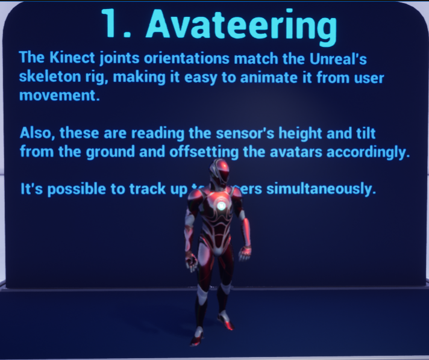
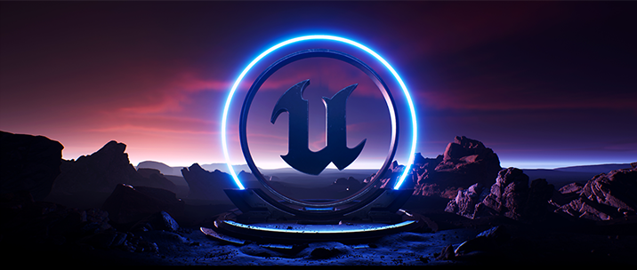
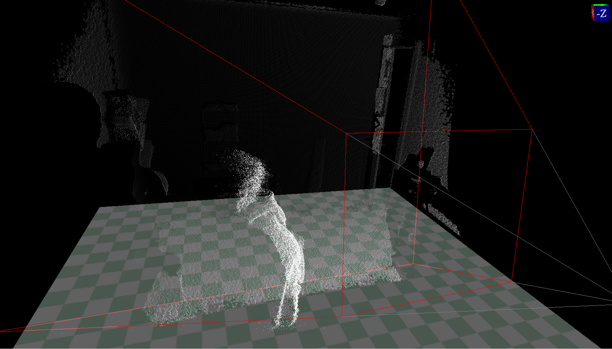
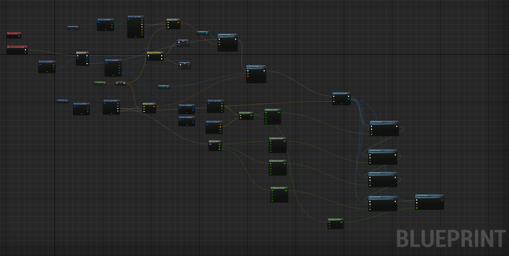

# Research Area and Digital New Media Project

As an individual who has studied and performed music, and has interests in video games, animation, and immersive technology, I have always been fascinated by the ways in which technology and art intersect to create novel experiences. For the purposes of my research at Drexel I am, in some ways, continuing to study the uses of spatial sound for interactive media. My current studies have led me to explore the intersection of sound, body, movement, and space. The ultimate goal is to get closer to creating or sparking moments of play, gameplay, and interactivity in a procedural/generative manner using these topics.

With the project in the DIGM 540 course, I am focusing on creating a participatory experience prototype between a dancer and a participant using Unreal Engine 5.1 (UE), Kinect body tracking, and UE MetaSounds. The project aims to map Laban movement points, dance motif manipulations, and parameters of electronic sound to create an improvisational feedback loop. The dancer will manipulate and generate sound with their body and gesture, while the participant will be able to manipulate and influence the sounds the dancer hears. Hopefully, this will lead to the dancer and participant becoming co-authors in a spatiotemporal sonic narrative.

The use of different communicating technologies is crucial to facilitating the creation of the feedback loop. As mentioned earlier, I am using Unreal Engine 5.1, Kinect tracking, and MetaSounds. The Kinect V2 will be used to capture the movements of the dancer and record the body positional data (head, hands, joints, etc.). The current tracking plugin in use is the NeoKinect plugin from the UE marketplace.

UE Blueprints (BP) will be used to translate the data into useful values. I will likely need to create some custom BP node networks to handle specific data pairings, like calculating the distance between the hand and shoulder joints.

The Unreal Engine MetaSounds will be used to create the soundscape and allow for real-time manipulation of the sound parameters by both the dancer and the participant. MetaSounds is a node-based modular synth and DSP environment built into UE. Along with its connection with BP it provides a good tool for translating/encoding body data into sound parameters and connecting those to in-game interactions if need be.

The intersection of sound, body, movement, and space that the research is exploring, I believe, is a complex and dynamic area of research that requires a deep understanding of various fields such as music, dance, computer science, and digital media. By exploring the space between these fields and studying new areas around them, I hope to gain new insights into how technology can be used to facilitate the creation of interactive and immersive experiences based around the concepts of sound, body, movement, and space.

