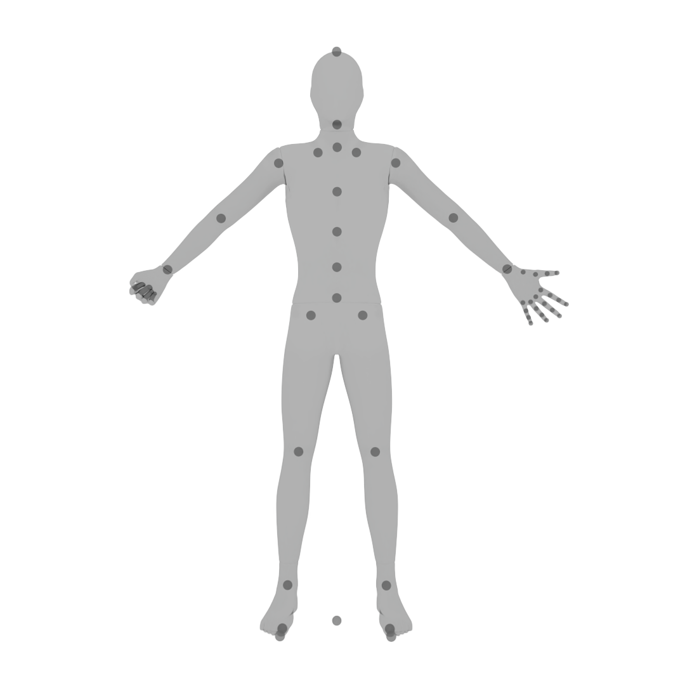
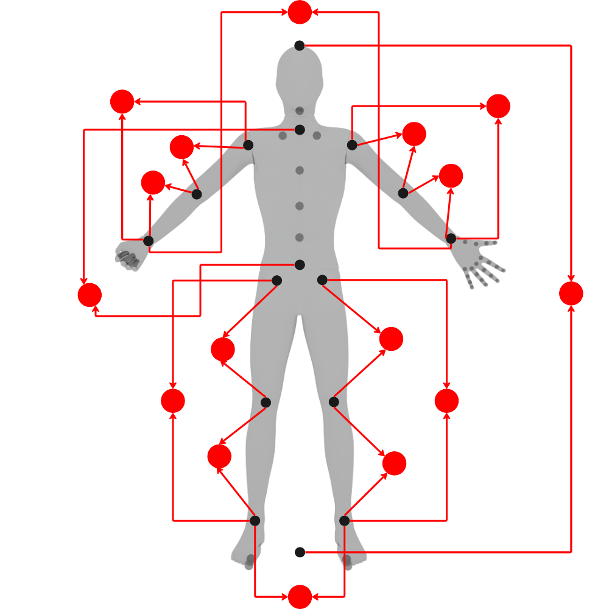
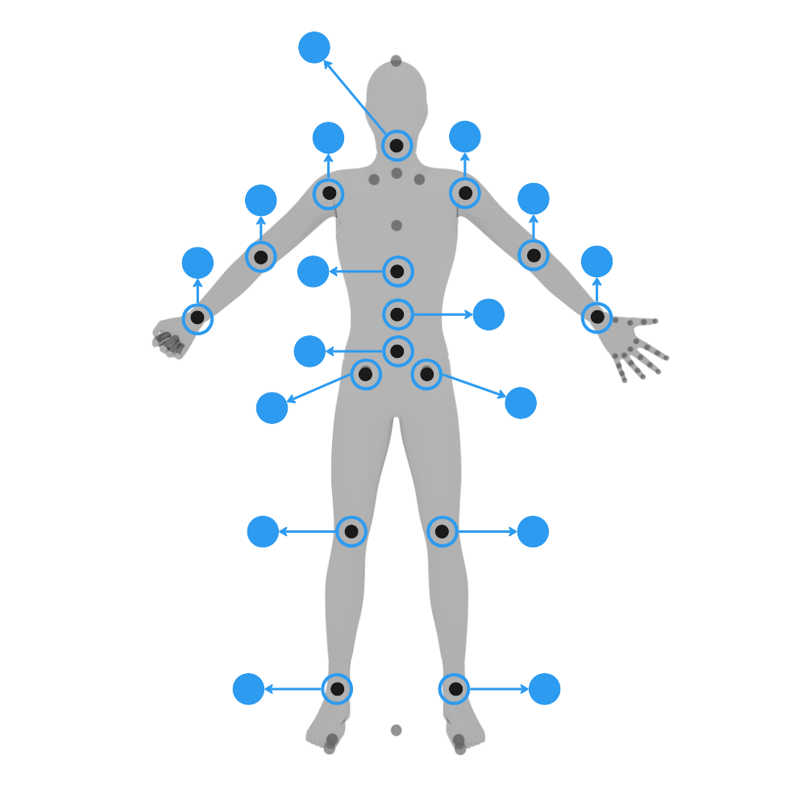
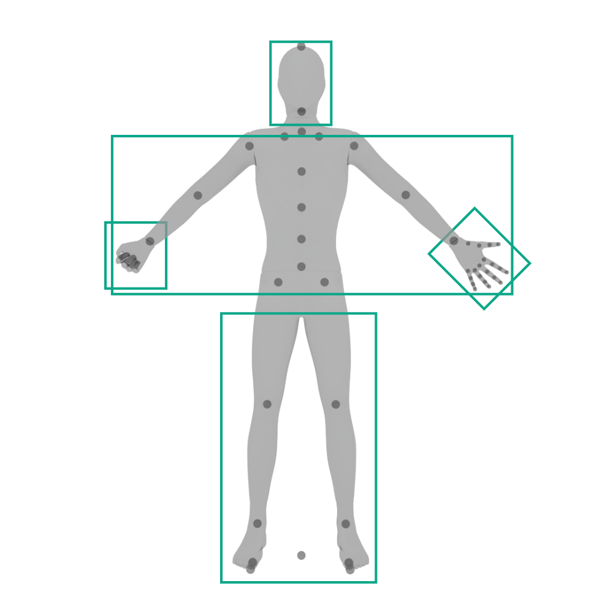
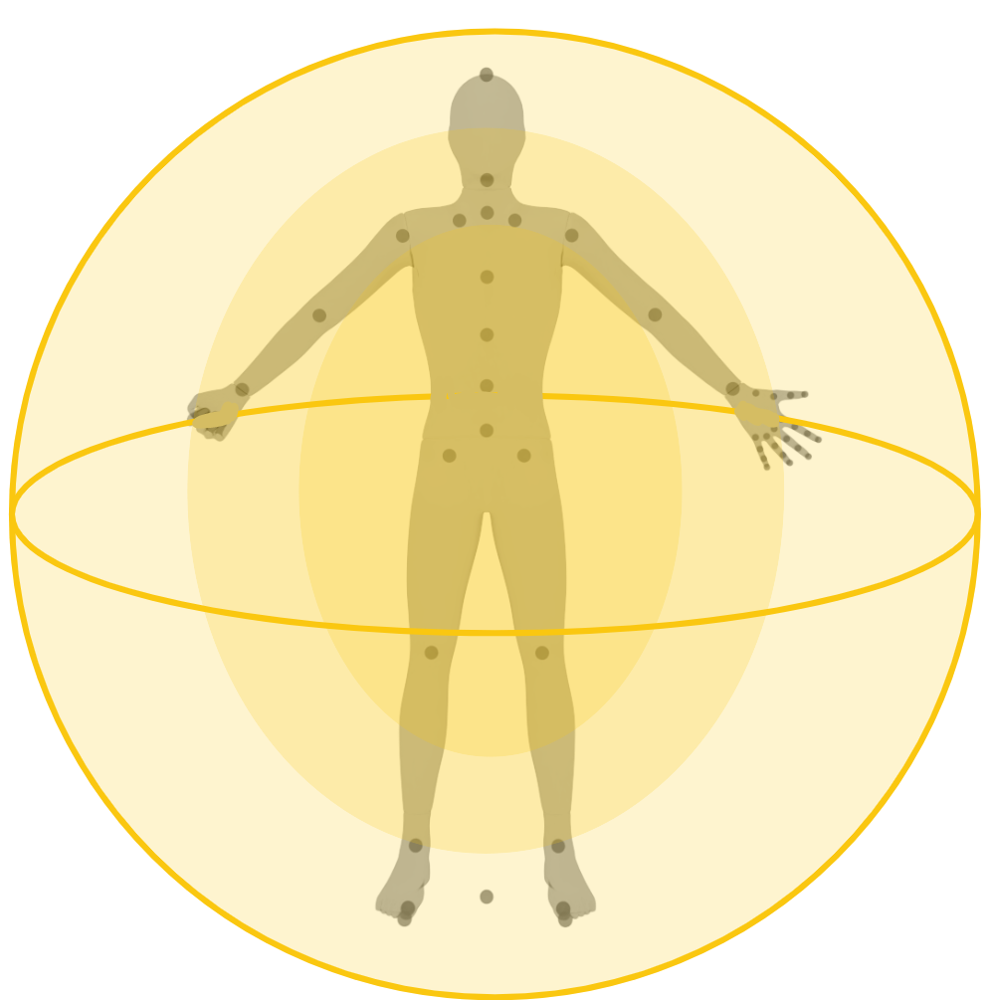
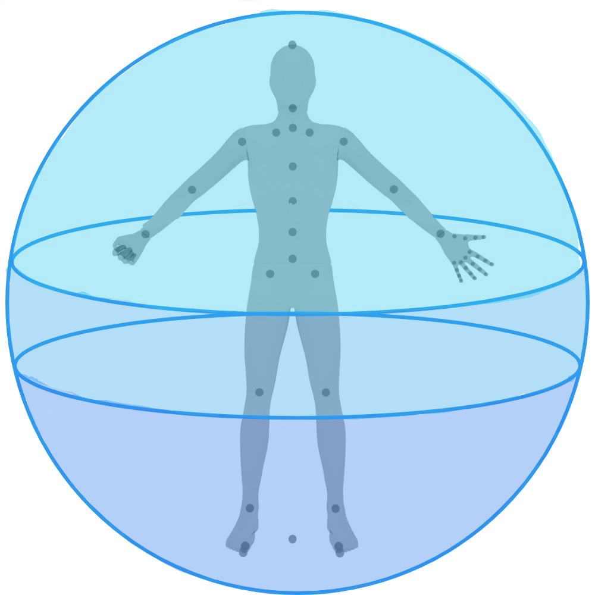

# Body Data Mappings (2D)

Since my research and other project-based explorations will be using the human body as the main input for the procedural sound synthesis system to be built in MetaSounds, it became apparent that there needed to be some explanation of the "data types" the body would provide that the system would read in.

The following images were achieved by first getting a human mannequin rig from Adobe Mixamo and importing it into Houdini to retendered out a PNG with a transparent background.

- The character chosen was "Mannequin."

- Something generic and lacking clothing/other discernible features was important to not distract/get in the way of the vector graphics.

- Sphere primitives were mapped in the rig's joint positions in Houdini so they would be visible in the render.

- Flat Redshift materials were applied to that the render would better fit with flat vector graphics to be added as an overlay.

The joint positions and numbers may not be representative of the final rig used for the project; these just serve as a good starting point to explain the data types.

> A render from Houdini that shows the joints of a human mannequin rig.

The first data type is based on the Distance between Joints, or the distances of bones//limbs. As seen in the image below.

The data that is being represented here is the value of the distance between two joints at any point in time/space. The data points, or containers, are represented by the solid red circles and the joints that the data is representing are connected to either side of a circle.

> Visual representations of "Distance between Joints" data type for body movement mapping data.

The second data type has to deal with Joint Rotations. See below in blue.

These data containers are represented by the solid blue circles and the circles joint with the connecter to the container are the joint whose value is being represented. This data would like to be represented in Pitch/Yaw/Roll (X/Y/Z) Euler rotational values in the engine. Although Quaternion representations can also be used.

> Visual representations of "Joint Rotations" data type for body movement mapping data.

Both of the above data types, Distances, and Rotations also take into account the 3D Positional value of each joint. This is just more difficult to represent in 2D and will be explained in greater detail in a later post.

The third data type will actually be a combination of Joint Distances and Joint Rotations. This data type is the Gestures of the body. Represented below in green.

The data containers are represented by green boxes and are encapsulating the body part the gesture is associated with. For now, it is planned to be open/closed Hands, open/closed Legs, open/closed Arms, and a potential final, Facial Expression data.

> Visual representations of "Body Gestures" data type for body movement mapping data.

It is also important to consider the reach of the limbs, which is borrowed from Laban's Kinesphere, and the concepts of Kinect Space.

These data areas can be seen below represented by varying degrees/shades of hue. Yellow for Close, Middle, and Far reach. Blue for Low, Middle, and High reach.

> Visual representations of reach "Close, Mid, and Far" data type for body movement mapping data.

> Visual representations of reach "Low, Mid, and High" data type for body movement mapping data.

